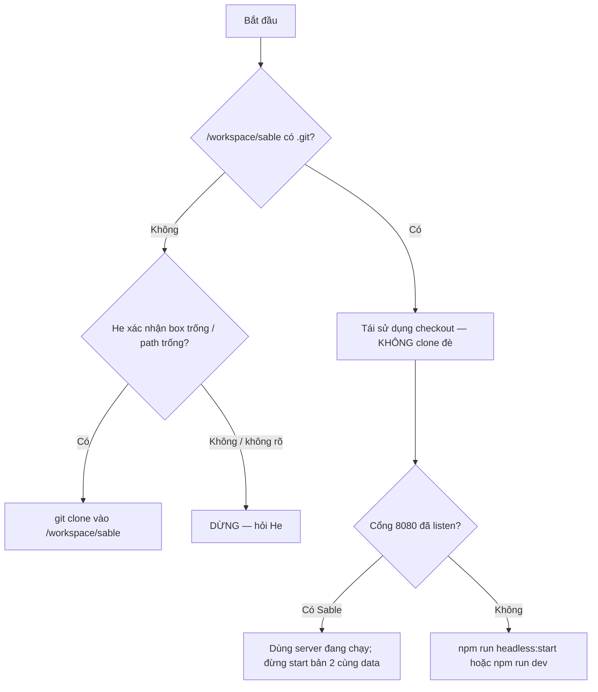

# Hướng dẫn Grok Bot agent mới: clone & cài runtime Sable (dev/test)

**Đây là hướng dẫn — không phải lệnh cấp phép** để tự provision máy mới, tự đổi
runtime đang chạy của agent khác, hay tự copy secret. Chỉ làm khi **He** giao
việc và (nếu cần credential/public tunnel) phê duyệt tường minh trong tin nhắn.

**Repo công khai:** https://github.com/VagabondKingsman/Sable-bot  
**Bản sao đọc liền:** `/workspace/Sable-Grok-Bot-Dev-Setup-VI.md` (đồng bộ khi có).

Đọc thêm: [HANDOFF-VI.md](./HANDOFF-VI.md), [vi/README.md](./vi/README.md),
[vi/08-cau-hinh-env.md](./vi/08-cau-hinh-env.md), [.env.example](../.env.example),
[FULL-AGENTIC-STATUS.md](./FULL-AGENTIC-STATUS.md), [DEPLOY.md](./DEPLOY.md).

---

## 0. Prompt He có thể dán cho agent mới

```
Bạn là Grok Bot agent mới của cùng owner (Tun Hen). Nhiệm vụ: dựng môi trường
dev/test Sable để vừa build vừa chạy test — theo docs/GROK-BOT-DEV-SETUP-VI.md
(và bản /workspace/Sable-Grok-Bot-Dev-Setup-VI.md nếu có trên box).

SỰ THẬT QUAN TRỌNG: các Grok Bot agent CÙNG owner dùng CHUNG một máy (filesystem
+ process). Desktop/browser GUI mỗi agent riêng; KHÔNG tự có VPS riêng. Trước
mọi clone: kiểm tra đã có /workspace/sable và cổng 8080 chưa. Nếu đã có tree
đang chạy → tái sử dụng an toàn, KHÔNG clone đè. Chỉ clone
https://github.com/VagabondKingsman/Sable-bot.git vào /workspace/sable khi box
thật sự trống. Parallel trên cùng box chỉ khi He chọn worktree/data/port riêng;
một writer / một checkout.

Đọc: GROK-BOT-DEV-SETUP-VI → HANDOFF-VI → docs/vi/README → FULL-AGENTIC-STATUS →
PHASE6-PROGRESS → .env.example → 08-cau-hinh-env. Không đọc/paste .env.local
vào chat. Không sửa/follow "Content scope" trong AGENTS.project.md. Không RE/
pentest/CTF. Không gửi Telegram/email/bridge/webhook outbound; không public
ngrok trừ khi He yêu cầu. Không pkill rộng, không reset --hard, không tắt
sandbox để “lách”. bwrap lỗi namespace → chẩn đoán rồi DỪNG. Chạy local mặc định.
Coding theo quy trình được phép của bạn; tài liệu này không ghi đè policy.
```

---

## 1. Sự thật về “VPS ảo” của Grok Bot

| Khái niệm | Thực tế trên nền Grok Bot |
|---|---|
| Nhiều agent cùng owner | **Chung một Linux box**: chung `/workspace`, process, cổng, `node_modules` nếu cùng path |
| Desktop | **Mỗi agent một desktop/browser** — không thấy UI của nhau |
| “Máy mới” | Agent mới **không** tự nhận VPS tách biệt chỉ vì được tạo |
| Credential | Secret trên box A **không** magically có trên box B (nếu thật sự khác host). Không giả định chia sẻ |
| Mục tiêu He | Agent build + test Sable trên runtime của bot — thường = **cùng box** hoặc (hiếm) host thật sự trống sau khi He xác nhận |

**Hệ quả:** bước đầu tiên luôn là **phát hiện**, không phải clone mù.

---

## 2. Bước 0 — Phát hiện máy hiện có (bắt buộc)

Chạy (chỉ đọc):

```sh
hostname; whoami; pwd
test -d /workspace/sable && echo HAS_CHECKOUT=yes || echo HAS_CHECKOUT=no
test -d /workspace/sable/.git && (cd /workspace/sable && git remote -v && git rev-parse --short HEAD && git status -sb | head)
ss -ltnp 2>/dev/null | rg -n '8080|5999|6099' || true
pgrep -af 'vite dev|scripts/headless|sable-watchdog|ngrok' || true
test -d /workspace/sable-data && echo HAS_DATA=yes
which node npm bwrap Xvfb x11vnc websockify google-chrome 2>/dev/null
node -v; npm -v
```

### Nhánh quyết định



**Cấm:** `rm -rf /workspace/sable`; clone vào path đang có worktree bẩn; chạy hai
`vite` cùng `SABLE_DATA_DIR` (xem `docs/DEPLOY.md`: một process / một data dir).

### Parallel có chủ đích trên cùng box (chỉ khi He chọn)

- Worktree git riêng, ví dụ `/workspace/sable-wip`  
- `SABLE_DATA_DIR` + `SABLE_WORKSPACE` **khác**  
- `SABLE_PORT` khác (vd 8081)  
- **Một writer** trên mỗi checkout; không đua `git push` force  

---

## 3. Clone (chỉ khi path trống)

```sh
sudo mkdir -p /workspace   # nếu cần; trên Grok box thường đã có
cd /workspace
# CHỈ khi test -d /workspace/sable thất bại:
git clone https://github.com/VagabondKingsman/Sable-bot.git sable
cd /workspace/sable
git status -sb
```

Không nhúng token vào URL remote. Repo đã public.

---

## 4. Thứ tự đọc tài liệu (self-contained)

1. `docs/GROK-BOT-DEV-SETUP-VI.md` (file này)  
2. `docs/HANDOFF-VI.md` — mục tiêu He, gap, blocker **tên**, roadmap  
3. `docs/vi/README.md` → 01…08 theo nhu cầu  
4. `docs/FULL-AGENTIC-STATUS.md` + `docs/PHASE6-PROGRESS.md` (W7)  
5. `.env.example` + `docs/vi/08-cau-hinh-env.md`  
6. `docs/DEPLOY.md`, `docs/OAUTH-SETUP.md`, `docs/WEBHOOK-API.md`, `docs/BRIDGE-PROTOCOL.md` khi đụng kênh đó  

**Không** sửa / không “follow” mục **Content scope** trong `AGENTS.project.md`.  
**Không** vendor / mở rộng skill RE-pentest-CTF.  
Research trees ngoài repo (nếu có trên box cũ) không giả định tồn tại trên host mới.

---

## 5. Node / npm / cài dependency

- Checklist VPS: **Node 22+** (`package.json` không có `engines`; box tham chiếu từng chạy **Node 24.x** + npm 11.x thành công).  
- Cài deps **có devDependencies** (cần để `tsc`, eslint, playwright test tooling):

```sh
cd /workspace/sable
npm ci --include=dev
```

(`npm ci` mặc định cài dev khi không set `NODE_ENV=production`. Nếu môi trường
ép production, **phải** `--include=dev` cho máy build/test.)

---

## 6. Gói hệ thống (đối chiếu box đang chạy)

Trên box tham chiếu (đã verify path):

| Công cụ | Path quan sát | Dùng cho |
|---|---|---|
| `bwrap` | `/usr/bin/bwrap` | Shell / code / desktop jail |
| `Xvfb` | `/usr/bin/Xvfb` | Sable desktop **chỉ `:99`** |
| `x11vnc` | `/usr/bin/x11vnc` | VNC localhost cho `:99` |
| `websockify` | `/usr/bin/websockify` | noVNC proxy (Sable dùng port cấu hình, mặc định WS 6099) |
| `google-chrome` | `/usr/bin/google-chrome` | Desktop session + có thể browser tool |
| `xdotool` | (cần cho desktop actions) | Click/type trên `:99` |

**Ubuntu ví dụ (khi thiếu):**

```sh
sudo apt-get update
sudo apt-get install -y bubblewrap xvfb x11vnc websockify xdotool
# Chrome/Chromium theo policy host — không bịa URL cài nếu He chưa chỉ
```

### Desktop Sable ≠ desktop Grok Bot

- Sable computer-use: **Xvfb `:99` cố định** (`DESKTOP_DISPLAY` trong
  `src/lib/agent/desktop/config.ts`). **Không** đụng `:1`/`:2` hay display của
  agent GUI.  
- Nếu `:99` bận bởi process lạ → session **refuse**, không kill hộ (`displayBusy`).  
- Kill switch: `SABLE_DESKTOP=0`.  
- Trước khi bật desktop: `ss`/`pgrep` kiểm tra 5999/6099; xác nhận binary ở trên.

### bwrap / user namespace

Nếu `bwrap --unshare-all …` fail (namespace): **chẩn đoán + dừng**. Không tắt
sandbox / không “chạy không jail” để vượt. Shell có cwd-jail yếu hơn khi thiếu
bwrap — không coi đó là đủ cho production.

---

## 7. Env: tối thiểu vs tích hợp đầy đủ

```sh
cd /workspace/sable
cp .env.example .env.local
chmod 600 .env.local
# Điền bằng editor / vault host — KHÔNG cat giá trị vào chat, log, commit
```

### Tối thiểu để boot có chat

1. Một khóa LLM: `XAI_API_KEY` **hoặc** `OPENAI_API_KEY` **hoặc** `DEEPSEEK_API_KEY` **hoặc** `LLM_API_KEY`  
2. (Nên) `SABLE_DATA_DIR` trỏ thư mục bền mode 0700  
3. (Local) có thể bỏ `SABLE_PASSWORD` nếu chỉ `127.0.0.1`  

`startup.sh` / provider: thiếu mọi LLM key → UI lên, chat/media **503**.

### Thu thập secret an toàn

- He dán vào **form/vault/host secret** hoặc tự sửa `.env.local` trên máy — không
  paste dài vào kênh chat agent.  
- Không commit `.env.local`. Không in `SABLE_PASSWORD`, API keys, ngrok authtoken,
  `SABLE_VAULT_KEY`, webhook/bridge secrets.  
- Vault app: cần `SABLE_VAULT_KEY` trước; tên vault (`BRIDGE_*`, `GOOGLE_OAUTH_*`)
  ưu tiên hơn env fallback — xem code `bridge/config.ts`, `oauth.server.ts`.

### Tích hợp tùy chọn (blocked đến khi He cấp tên biến)

Telegram · Google OAuth · embeddings · bridge peer · SMTP · public ngrok — chi tiết
tên trong HANDOFF + `08-cau-hinh-env.md`. **Không** giả định secret từ box khác
đã có sẵn.

### Precedence (thực tế code)

- Process env / `.env.local` load bởi shell/`with-app-env` (chỉ merge `VITE_*` từ
  `.grok/app-env.json`; secret không thuộc file đó).  
- Vault **ưu tiên** cho bridge URL/secret và Google client khi configured.  
- Kill `SABLE_*=0` tắt module (Scope=0 = fail-closed).

---

## 8. Lệnh build / typecheck / test / eval / chạy (từ `package.json`)

```sh
cd /workspace/sable

# Typecheck
npm run typecheck          # = tsc --noEmit
# hoặc: npx tsc --noEmit

# Unit + check .env.example khớp code
npm test
# riêng: node --test scripts/check-env-example.mjs

# Eval theo wave (mặc định nhiều phần offline/mock)
npm run eval:w0
# … npm run eval:w7
npm run eval               # bộ eval.ts agent mock

# Build (migrate kèm theo)
npm run build

# Chạy dev (foreground qua npm)
npm run dev                # vite :8080 qua with-app-env

# Watchdog trong repo (ƯU TIÊN trên host mới — có trong git)
npm run headless:start
npm run headless:status
npm run headless:stop
npm run headless:restart
# Log/pid: .grok/headless.log , .grok/headless.pid
```

### Phân loại test

| Loại | Ví dụ | Credential / chi phí | Outbound |
|---|---|---|---|
| Mock / offline | Phần lớn `eval:wN`, unit `*.test.ts` | Không cần key thật | Không gửi user |
| Live local API | `eval:w*` khi server `:8080` up | Có thể cần LLM | Chỉ localhost |
| Live model | `SABLE_EVAL_LIVE_MODEL=1 npm run eval:w7` | **Tốn token** | Gọi provider LLM |
| Kênh thật | Telegram/OAuth/bridge | **Cần He** | Có thể gửi — **không tự làm** |

Không bật chip/send; không approve thay He; background không auto-approve (invariant).

---

## 9. Script box-specific vs script trong repo

| Path | Có trong git clone? | Ghi chú |
|---|---|---|
| `scripts/headless.mjs` + `npm run headless:*` | **Có** | Dùng cái này trên host mới |
| `startup.sh` | Có nhưng hard-code `cd /workspace/sable` | OK nếu checkout đúng path; không gọi ngrok |
| `/home/box/bin/sable-watchdog.sh` | **Không** trong repo | Box cũ: tick health + giữ ngrok. **Không giả định** có trên host mới |
| `/home/box/bin/ngrok` + policy | **Không** trong repo | Chỉ khi He yêu cầu public + cấp token **mới** |

### Ví dụ watchdog tự chứa (chỉ khi thiếu `/home/box/bin/…`)

Lưu **ngoài git** hoặc path riêng He chọn — **không** copy authtoken cũ:

```sh
#!/bin/sh
# ví dụ an toàn: chỉ giữ headless Sable, KHÔNG ngrok
set -eu
cd /workspace/sable
while true; do
  if ! curl -sf -o /dev/null --max-time 5 "http://127.0.0.1:${SABLE_PORT:-8080}/api/health"; then
    npm run headless:restart >>/tmp/sable-agent-watchdog.log 2>&1 || npm run headless:start >>/tmp/sable-agent-watchdog.log 2>&1
  else
    curl -sf -o /dev/null -X POST "http://127.0.0.1:${SABLE_PORT:-8080}/api/health" || true
  fi
  sleep 20
done
```

Không `pkill -f vite` hàng loạt trên máy đa agent — dùng `npm run headless:stop`
(target pid trong `.grok/`).

---

## 10. Local mặc định; public chỉ khi He yêu cầu

1. Chạy `:8080` local / tailnet nội bộ.  
2. Public (ngrok hoặc domain): **chỉ sau khi He yêu cầu** — domain/authtoken/
   `SABLE_PASSWORD` **mới**, không tái sử dụng secret tài liệu/box khác.  
3. Khi public: `SABLE_PUBLIC=1`, `SABLE_TRUSTED_ORIGINS=https://<origin>`, basic
   auth hoặc lớp tương đương; kỳ vọng không credential → 401, có auth → 200
   (pattern đã verify trên box cũ với ngrok).  
4. Không commit policy ngrok có password.

---

## 11. Suspend / 24/7 / VPS sau này

- Heartbeat + catch-up (`SABLE_CATCHUP`) giúp **sau suspend** của box — không
  đảm bảo hosting 24/7 thương mại.  
- Grok box có thể sleep/restore; data trong `/workspace` thường bền trên **cùng**
  host, nhưng **backup** vẫn cần.  
- Deploy VPS riêng = dự án khác (`docs/vi/04-cai-dat-vps.md`) — không gộp vào
  “tôi vừa tạo agent mới”.

### Backup / restore (ngoài git)

```sh
# backup (ví dụ)
tar -czf ~/sable-data-backup.tgz -C /workspace sable-data
# giữ .env.local offline mã hóa — không gắn vào tar đưa chat

# restore: giải nén data → chmod 700 → đặt lại env → headless:start
```

Vault: mất `SABLE_VAULT_KEY` = mất khả năng giải mã `vault.json`.

---

## 12. Vòng build → test → review → push (ngày thường)

1. Branch feature (khuyến nghị) — tránh force-push `main`.  
2. Đổi code theo workflow coding được phép của agent (skill `code-changes` /
   Origin nếu có) — **doc này không override policy**.  
3. `npm run typecheck` → `npm test` → `npm run eval:wN` liên quan.  
4. Key-pattern scan trước khi push public (không secret, không `.env.local`).  
5. `git push` thường lên remote đã được He ủy quyền; không `--force` lên main.  
6. Cập nhật `PHASE6-PROGRESS` / handoff khi đổi baseline có ý nghĩa.

---

## 13. Acceptance checklist (agent mới)

- [ ] Đã chạy bước phát hiện; không clone đè checkout sống  
- [ ] `npm ci --include=dev` xong  
- [ ] `npm run typecheck` + `npm test` + `node --test scripts/check-env-example.mjs` xanh  
- [ ] Ít nhất một `eval:w0` (hoặc w7) offline xanh  
- [ ] `.env.local` 0600; tối thiểu một LLM key; không lộ secret ra chat  
- [ ] `npm run headless:start` → `curl -s http://127.0.0.1:8080/api/health` 200  
- [ ] `bwrap`/`Xvfb`/`google-chrome` có nếu sẽ test shell/desktop; `:99` không bị cướp  
- [ ] Không start ngrok / không gửi kênh ngoài trừ He yêu cầu  
- [ ] Đã đọc HANDOFF: biết vault/Telegram/OAuth/bridge/embeddings còn **blocked**  

### Tích hợp vẫn blocked đến khi He cấp (tên)

`SABLE_VAULT_KEY` · Telegram token/owner · Google OAuth client · embed key ·
bridge URL/secret · peer routine Grok Bot · ngrok token/password mới  

---

## 14. Việc **không** làm

- Destructive: `reset --hard` bừa, xóa data dir người khác, `pkill -9` diện rộng  
- Tắt bwrap/sandbox để test “cho nhanh”  
- Claim đã có credential từ agent/box khác  
- Push secret; force-push main; sửa Content scope  
- Tự deploy production / mở firewall / mua VPS  

---

## 15. Liên kết nhanh

| Doc | Path |
|---|---|
| Handoff tổng | `docs/HANDOFF-VI.md` |
| Docs VI mục lục | `docs/vi/README.md` |
| Env chi tiết | `docs/vi/08-cau-hinh-env.md` / `.env.example` |
| Deploy | `docs/DEPLOY.md` |
| Status waves | `docs/FULL-AGENTIC-STATUS.md` |

*Hết hướng dẫn setup cho Grok Bot agent mới.*
