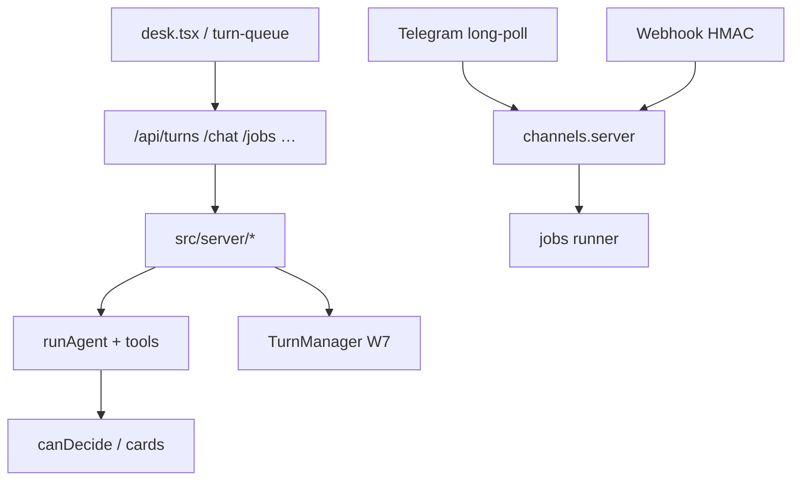

# Sable — Handoff cho agent AI tiếp tục (tiếng Việt)

**Mục đích.** File này đủ để một agent/AI khác (hoặc người) tiếp tục cộng tác trên
repo Sable **không cần** lịch sử chat. Đây là tài liệu bàn giao, **không** phải
Canvas Page. Không tự triển khai tính năng mới chỉ vì đọc file này.

**Ngày baseline (ICT):** 2026-11-06 ~00:35 Asia/Saigon  
**Nhánh / commit:** `main` @ `f847eeb` (stamp); body `fc4c91f`; env parent `3136672`  
**Remote công khai:** `https://github.com/VagabondKingsman/Sable-bot`  
**Owner:** Tun Hen (“He”). Một builder trên box; He duyệt credential / gửi ra ngoài /
deploy production / đổi visibility.

**Bản sao đọc liền:** `/workspace/Sable-Handoff-VI.md` (cùng nội dung, ngoài git
hoặc đồng bộ khi regenerate).

**Agent Grok Bot mới cần dựng runtime:** xem [GROK-BOT-DEV-SETUP-VI.md](./GROK-BOT-DEV-SETUP-VI.md) (phát hiện shared box trước khi clone).

---

## 0. Prompt ngắn để agent mới bắt đầu an toàn

```
Bạn đang tiếp quản Sable (desk agent một người dùng) tại /workspace/sable,
repo public github.com/VagabondKingsman/Sable-bot, nhánh main. Đọc lần lượt:
docs/HANDOFF-VI.md → docs/vi/README.md → docs/FULL-AGENTIC-STATUS.md →
docs/PHASE6-PROGRESS.md (W7) → .env.example → docs/vi/08-cau-hinh-env.md.
Không đọc/paste .env.local. Không in secret. Không làm RE/pentest/CTF.
Không sửa mục "Content scope" trong AGENTS.project.md. Không đụng
/workspace/reverse-skill-research (chỉ đọc NOTICE). Không gửi tin/email/
Telegram/bridge ra ngoài, không deploy production, không xin/điền credential
trừ khi He phê duyệt tường minh trong tin nhắn mới. built ≠ production-ready.
Xác minh bằng tsc / npm test / eval:wN trước khi tuyên bố xanh. Làm đúng
nhiệm vụ He giao trong tin hiện tại; cập nhật handoff nếu đổi baseline.
```

---

## 1. Mục tiêu của He (đã thống nhất qua các wave)

| Mục tiêu | Chi tiết |
|---|---|
| Single-user | Một operator; không multi-tenant |
| Dev trên box này → VPS riêng sau | Box: `/workspace/sable`, data `/workspace/sable-data`; VPS: xem `docs/vi/04-cai-dat-vps.md` |
| Giữ lõi Sable | Desk agent + tools + jobs; không biến thành SaaS |
| Kênh chat | **Chỉ Telegram + webhook** (Discord/Slack đã cắt Phase 5) |
| An toàn | Mọi gửi/ghi nhạy cảm = thẻ duyệt owner; background không tự duyệt |
| Full Agentic W0–W7 | Đã ship trong repo; một số phần **cần cấu hình** / chưa live-test |
| Docs VI | Bộ `docs/vi/` + `.env.example` để He xem / giới thiệu người mới |

**Không phải mục tiêu:** thêm skill RE/pentest/CTF; claim thuật toán nội bộ Grok;
vendor GPL CTF orchestrator; copy code AIC (PolyForm Perimeter — chỉ học design).

---

## 2. Đường dẫn & entry points

| Path | Vai trò |
|---|---|
| `/workspace/sable` | Root app (git) |
| `/workspace/sable-data` | `SABLE_DATA_DIR` mặc định trên box (0700) |
| `/workspace/sable-workspace` | Jail fs/shell/browser/code |
| `/workspace/Sable-Docs-VI.md` | Docs VI nối tiếp (ngoài git) |
| `/workspace/Sable-Handoff-VI.md` | Bản handoff standalone |
| `/workspace/sable-source-w7-*.tgz` | Package wave (nếu còn) |
| `startup.sh` | Revive box (đường `/workspace/sable`) |
| `/home/box/bin/sable-watchdog.sh` | Watchdog box + ngrok (box-specific) |
| `scripts/headless.mjs` | Watchdog 24/7 portable |
| `src/routes/api/*` | HTTP API |
| `src/server/*.server.ts` | Server facades (chat, turns, jobs, channels, …) |
| `src/lib/agent/*` | Agent core (loop, tools, turns, bridge, …) |
| `src/components/sable/*` | UI desk |
| `skills/` | SKILL.md + `routing.json` + `_meta/NOTICE-*` |
| `evals/` | Eval fixtures |
| `.env.local` | **Bí mật — không đọc vào chat / không commit / không copy vào handoff** |
| `.env.example` | Template công khai |

**Chạy:** `npm run dev` hoặc `npm run headless:start` → `:8080` (Vite).  
**Ngrok box (nếu còn):** hostname trong `SABLE_TRUSTED_ORIGINS` / OAuth redirect —
không nhúng token ngrok vào tài liệu.



---

## 3. Ma trận tính năng (built ≠ production-ready)

Chú thích trạng thái:

- **Code:** có trong repo / kill switch  
- **Unit/Eval:** có test hoặc `eval:wN` (mock hoặc live có ghi)  
- **Live trên box này (2026-11-06):** quan sát API/env **không** suy diễn VPS  
- **Production-ready:** chỉ khi credential + TLS + giám sát + He duyệt deploy  

### Phase 1–4 (rút gọn)

| Hạng mục | Code | Test/eval | Live box | Ghi chú |
|---|---|---|---|---|
| Chat + tools file/fetch | Có | eval agent / harness | Chat OK nếu có LLM key | Cần khóa LLM |
| Memory học được | Có | Phase3/4 | On (default) | `SABLE_MEMORY` |
| Telegram | Có | channels tests | **configured=false** | Thiếu token/owner ids |
| SMTP | Có | — | Chưa cấu hình | |
| Desk sync | Có | desk tests | — | `SABLE_DESK_SYNC` |
| spawn / skills / MCP | Có | p4 evals (historic) | — | |
| Triggers webhook/watch | Có | p4-triggers historic | Webhook **configured=true** (secret có trong env; không ghi giá trị) | |
| Shell bwrap / browser | Có | Phase5 live historic | Flags trong env local | Cần `bwrap`/Chrome |
| Voice / profiles / headless | Có | Phase5 | Headless/watchdog dùng trên box | |
| Eval `npm run eval` | Có | 29/29 historic Phase5 | — | Mock + một số live |

### Full Agentic W0–W7

| Wave | Tính năng | Code | Eval | Live box (quan sát) | Chặn / cần He |
|---|---|---|---|---|---|
| W0 | Heartbeat, vault, router, ScopeGate, journal, tool-index | Có | eval:w0 historic PASS | Vault **configured=false** (không `SABLE_VAULT_KEY`) | Vault key |
| W1 | Planner, workspaces, budget, scope UI | Có | eval:w1 | — | `SABLE_MODEL_LIGHT` khuyến nghị |
| W2 | Trace, media, Canvas | Có | eval:w2 | Media cần provider; video **cần** provider thật | |
| W2a | Triage, brief, chips, audit | Có | eval:w2a; held-out triage W2c | Brief default off | Light model → triage tốt hơn |
| W2b | Gmail + Calendar OAuth | Có | eval:w2b mock 15/15 | Connectors **not-configured** (vault + Google client) | OAuth client + vault |
| W2c | Share links, harden CSRF/rate, media tool | Có | eval:w2c | Harden = **Vite only** (gap Nitro) | Share vẫn sau basic auth trên ngrok trừ khi He exempt |
| W3 | Desktop `:99` | Có | eval:w3 historic 11/11 | On-demand; idle 10 phút | RAM + Xvfb/Chrome |
| W4 | Research cite + code worktree | Có | eval:w4; live cite **26/26** (historic W4) | — | Cap USD |
| W5 | Vector hybrid + self-eval | Có | eval:w5; paraphrase R@5 **0.42** hash | Embedder **hash-v2-512**; thiếu OPENAI embed | Embeddings key hoặc local |
| W6 | Bridge `sable.bridge.v1` | Có | eval:w6 mock | outbound/inbound **not ready**; problems URL+secret | Vault bridge + peer routine He tạo |
| W7 | Turn manager, composer, reply, TG async | Có | eval:w7 8 pass + skip (historic); live steer đã thử với `SABLE_EVAL_LIVE_MODEL=1` | `/api/turns` enabled cap 3 | Kill `SABLE_CHAT_QUEUE=0` **chưa** verify live fallback trong phiên docs (gap) |

**Số đo đã ghi (historic, không tự bịa mới):** xem `docs/PHASE6-PROGRESS.md` /
`docs/FULL-AGENTIC-STATUS.md` / `docs/vi/01-gioi-thieu.md`. Ví dụ: research
26/26 cites; triage held-out 65% rules / 93.3% với light model; hybrid keyword
cao trên bộ tự soạn; paraphrase 0.42 với hash; npm test sau W7 **197 + 413**
(historic 2026-11-05 ICT). **Không** lấy các số audit npm cũ làm “hiện tại” —
cần `npm audit` mới nếu đánh giá bảo mật deps.

---

## 4. Baseline kỹ thuật & lệnh kiểm tra

### Git

- Branch: `main`
- Commit handoff kỳ vọng sau commit riêng: xem tip `main` (env docs = `3136672`;
  commit handoff sẽ đứng trên đó).
- Public repo: đã push docs VI + env example.

### Lệnh (chạy lại khi tiếp quản)

```sh
cd /workspace/sable
npx tsc --noEmit
npm test                          # gồm scripts/check-env-example.mjs
npm run eval:w0   # … eval:w7
# W7 live model (tốn token): SABLE_EVAL_LIVE_MODEL=1 npm run eval:w7
curl -s http://127.0.0.1:8080/api/health
```

### Kết quả quan sát gần đây

| Check | Kết quả | Loại |
|---|---|---|
| `tsc --noEmit` sau env docs | exit 0 | **Rerun** ~00:35 ICT 2026-11-06 |
| `scripts/check-env-example.mjs` | pass | **Rerun** cùng lúc |
| `/api/health` | 200 | **Rerun** |
| `/api/turns?thread=…` | `enabled:true`, `cap:3` | **Rerun** |
| `/api/vault` | configured **false** | **Rerun** |
| `/api/bridge` | outbound/inbound not ready | **Rerun** |
| `/api/connectors` | gmail/gcal not-configured (vault) | **Rerun** |
| `/api/channels` | telegram configured false; webhook configured true | **Rerun** |
| `/api/vector` | hash-v2-512; openai/xai/local skipped (lý do trong JSON) | **Rerun** |
| `npm test` full 197+413 | PASS theo PHASE6 W7 | **Historic** 2026-11-05 ICT — **chưa** rerun full trong phiên handoff |
| eval:w0…w7 | xanh theo PHASE6 W7 | **Historic** |
| Headless UI W7 (composer/menu/quote/PINEAPPLE) | PASS | **Historic** W7 |
| ngrok 401/200 | PASS W7 package | **Historic** — xác nhận lại nếu còn tunnel |

---

## 5. Trạng thái công việc docs/env (đã xong trước handoff)

| Deliverable | Path | Commit |
|---|---|---|
| Docs VI bộ 01–07 | `docs/vi/*` | `0b3273e` |
| `.env.example` (~218 tên biến unique theo nhóm) + check script | `.env.example`, `scripts/check-env-example.mjs` | `3136672` |
| Hướng dẫn env VI | `docs/vi/08-cau-hinh-env.md` | `3136672` |
| Concat docs | `/workspace/Sable-Docs-VI.md` | ngoài git |
| Root README link VI + env | `README.md` | `0b3273e` / `3136672` |

**Tối thiểu boot (3–5 biến):** một LLM key (`XAI_API_KEY` / …); nên có
`SABLE_DATA_DIR`; nếu public: `SABLE_PASSWORD` + `SABLE_TRUSTED_ORIGINS`
(+ `SABLE_PUBLIC=1`). Chi tiết: `docs/vi/08-cau-hinh-env.md`.

**Tên biến có trong `.env.local` trên box (chỉ TÊN, không giá trị):**  
`CHAT_RATE_LIMIT`, `CHAT_RATE_WINDOW_MIN`, `SABLE_BROWSER`, `SABLE_FETCH_FAKE_IP`,
`SABLE_PUBLIC`, `SABLE_SHELL`, `SABLE_TRUSTED_ORIGINS`, `SABLE_WATCH_TICK_S`,
`SABLE_WEBHOOK`, `SABLE_WEBHOOK_SECRET`, `XAI_API_KEY`.  
**Không** có trong env local (theo lần đọc tên): `SABLE_VAULT_KEY`, Telegram
token/owner, Google client, bridge URL/secret, `OPENAI_API_KEY` (embed).

---

## 6. Blockers / credential (CHỈ TÊN)

| Tên | Mở khóa |
|---|---|
| `SABLE_VAULT_KEY` | Vault store → OAuth tokens, bridge vault entries |
| `SABLE_GOOGLE_CLIENT_ID` / `SECRET` hoặc vault `GOOGLE_OAUTH_*` | Gmail/Calendar live |
| `SABLE_TELEGRAM_TOKEN`, `SABLE_TELEGRAM_OWNER_IDS` | Telegram live |
| `OPENAI_API_KEY` / `SABLE_EMBED_*` | Semantic embeddings (bỏ hash 0.42) |
| `SABLE_MODEL_LIGHT` | Triage/self-eval model path |
| Vault `BRIDGE_PEER_URL`, `BRIDGE_SECRET` (≥32), optional `BRIDGE_PEER_TOKEN` | Bridge live |
| Grok Bot webhook routine (phía peer) | He tạo/duyệt — Sable không tạo hộ |
| Ngrok authtoken / policy (box) | Tunnel — không commit |

**Thiếu live test có chủ đích:** OAuth Google thật; Telegram E2E với bot thật;
embeddings thật; bridge peer thật; **`SABLE_CHAT_QUEUE=0` fallback live** (trừ
khi agent sau này verify và cập nhật handoff).

---

## 7. Hạn chế / gap / sự cố đã biết

1. **Hash embeddings:** paraphrase R@5 **0.42** (W5, bộ tự soạn) — không coi là
   semantic SOTA.
2. **Harden CSRF/rate:** middleware Vite; **chưa** gắn Nitro production build.
3. **npm audit residual:** từng ghi trong W2c (nodemailer, better-auth plugins
   không dùng, …). **Cần chạy `npm audit` mới** — không lặp số cũ như hiện tại.
4. **better-auth 1.7 thử rồi rollback** (vỡ API `genericOAuthClient` /
   `signInWithOAuth2`) — ở lại 1.6.x; advisories magic-link/oauth-proxy/device-auth
   **không** dùng trong app.
5. **Box restore mất `node_modules` / mất uncommitted** (W2c) — bài học: commit
   theo item; `npm ci` sau restore.
6. **Planner `agent` steps** một phần dry-run; budget chưa móc mọi usage field.
7. **Bridge** replay nonce in-memory; một peer; ngrok basic auth chắn inbound
   trừ khi proxy exempt HMAC paths.
8. **Canvas share** trên ngrok vẫn sau basic auth trừ khi He sửa traffic policy
   (`docs/CANVAS-SHARE.md`).
9. **Không** claim quyền truy cập thuật toán nội bộ Grok Bot / xAI — W7 chỉ
   mirror hành vi *quan sát được* (steer/queue/…).

### License / NOTICE

| Nguồn | Ràng buộc |
|---|---|
| AIC | PolyForm Perimeter — **không copy code**; học design |
| OpenClaw | MIT — ý tưởng sandbox, không vendor bừa |
| reverse-skill | MIT core — attribution `skills/_meta/NOTICE-reverse-skill.md`; **không** vendor GPL CTF-Sandbox-Orchestrator; không đụng tree research ngoài NOTICE |
| OpenDuet | MIT patterns — `NOTICE-openduet.md`; không vendor CopilotKit Intelligence |

### Safeguards (giữ nguyên)

- Approvals; background never auto-approve; bwrap; SSRF; ScopeGate; vault
  names-only; kill switches; owner-only channel; không RE skills; **không**
  sửa/follow mục Content scope trong `AGENTS.project.md`.

---

## 8. Deploy / backup / migration (tóm)

1. VPS: Node 22+, `npm ci`, `bwrap`, (desktop) Xvfb/x11vnc/websockify/Chrome.
2. Secrets chỉ host env / secret manager; `SABLE_DATA_DIR` ổ bền 0700.
3. Một process / một data dir (`docs/DEPLOY.md`).
4. TLS reverse proxy; cân nhắc exempt HMAC paths; `SABLE_TRUSTED_ORIGINS`.
5. Backup: tar data + `.env.local` offline mã hóa.
6. Restore: giải nén data, env, `npm ci`, headless/systemd, health check.
7. Package wave: tarball exclude `node_modules`/`.env*` + key-pattern scan.

Chi tiết: `docs/vi/04-cai-dat-vps.md`, `docs/FULL-AGENTIC-STATUS.md` checklist.

---

## 9. Roadmap ưu tiên (không tự làm nếu He chưa giao)

| Ưu tiên | Việc | Phụ thuộc | Acceptance | Rollback / kill |
|---|---|---|---|---|
| P0 | He cấp `SABLE_VAULT_KEY` + restart | He | `/api/vault` configured true | xóa key / `SABLE_VAULT=0` |
| P0 | Verify `SABLE_CHAT_QUEUE=0` → desk `/api/chat`, turns 409 | — | eval hoặc thủ công | bật lại =1 |
| P1 | Telegram token + owner ids | He | `/api/channels` running; tin riêng OK | unset token / `SABLE_CHANNELS=0` |
| P1 | Google OAuth client + Connect | He + vault | connectors connected; send cần duyệt | Disconnect / `SABLE_OAUTH=0` |
| P1 | Embeddings thật | He key hoặc local model | eval:w5 paraphrase gate nếu semantic | `SABLE_VECTOR=0` / hash |
| P2 | Bridge vault + peer routine | He cả hai đầu | mock ping + peer pong verified | `SABLE_BRIDGE=0` |
| P2 | `npm audit` mới + quyết định bump | — | báo cáo diff; không bump mù | revert package-lock |
| P2 | Wire harden vào production server **hoặc** chốt headless vite | quyết định kiến trúc | CSRF/rate trên public path | `SABLE_CSRF=0` tạm (không khuyến nghị) |
| P3 | VPS deploy + TLS + backup drill | He duyệt production | checklist FULL-AGENTIC | dừng systemd |
| P3 | `SABLE_MODEL_LIGHT` | He chọn model | triage/self-eval dùng light | unset |

### Cần phê duyệt tường minh của He (không suy từ handoff)

- Cung cấp / điền bất kỳ credential  
- Gửi email / Telegram / bridge / webhook outbound thật  
- Deploy production / mở port / đổi DNS  
- Đổi visibility repo hoặc exempt basic auth cho `/s/` hay HMAC paths  
- Chi tiêu model lớn (research/desktop dài) ngoài eval đã quen  

---

## 10. Checklist 30 / 60 / 120 phút khi tiếp quản

### 0–30 phút

1. Đọc file này + `docs/vi/README.md` + `FULL-AGENTIC-STATUS.md`.  
2. `git status` / `git log -5` / xác nhận `main` tip.  
3. **Không** `cat .env.local`. Kiểm tra health + vault/bridge/channels/vector
   status (như mục 4).  
4. `npx tsc --noEmit` + `node --test scripts/check-env-example.mjs`.

### 30–60 phút

5. `npm test` (hoặc subset nếu He cần nhanh) — ghi nhận pass/fail **mới**.  
6. `npm run eval:w7` (offline).  
7. Đối chiếu gap mục 6–7 với mong muốn He trong tin nhắn mới.

### 60–120 phút

8. Chỉ khi He giao: chuẩn bị (không tự gửi) bước vault/Telegram/OAuth theo
   `08-cau-hinh-env.md`.  
9. Verify kill `SABLE_CHAT_QUEUE=0` nếu còn gap.  
10. Cập nhật `HANDOFF-VI.md` baseline (commit, ngày ICT, test rerun).

---

## 11. Kiểm toán mâu thuẫn docs ↔ code (đã biết / cần thận)

| Chủ đề | Docs | Code / quan sát | Cách xử lý |
|---|---|---|---|
| Node version | Checklist “22+” | Không có `engines` trong package.json; box từng Node 24 | Ghi “22+ theo checklist”, không bịa engines |
| `.env.example` | Trước 2026-11-06 không có | Đã có + check script | Dùng example làm SoT tên biến |
| SABLE_JOB_APPROVAL_TTL | PHASE3 nói TTL_H 24h | Code: `TTL_MIN` ghi đè hoặc `TTL_H` default 24 | Cả hai trong `.env.example` |
| Model light default | Một số extract nhầm `gpt-4.1-mini` | Router: trống → hard | Docs 08: trống = soft fallback hard |
| Webhook configured | — | Box: secret có → configured true | Không suy là đã có client outbound |
| Production Nitro harden | DEPLOY/FULL-AGENTIC ghi gap | Vite middleware | Giữ gap cho đến khi wire |
| Eval scores | PHASE6 | Bộ tự soạn / held-out tách | Không trộn; nói rõ nguồn |

**Uncertain — không khẳng định:** trạng thái ngrok/watchdog sau mọi reboot;
RSS chính xác từng phút; `npm audit` hiện tại; liệu He đã tạo peer bridge bên
Grok Bot chưa (giả định **chưa** cho đến khi He nói).

---

## 12. Quy ước làm việc tiếp

1. **Một builder** trên tree; backup trước wave lớn (`sable-backup-pre-w*.tgz`).  
2. Commit theo item; cập nhật `PHASE6-PROGRESS` / handoff khi đổi baseline.  
3. Evidence: lệnh + output rút gọn; phân biệt historic vs rerun.  
4. Không secret trong git/chat/handoff; không force-push lịch sử nhạy cảm.  
5. Public repo: mọi thứ commit phải sạch key-pattern scan.  
6. He viết tiếng Việt; báo cáo thời gian **ICT (Asia/Saigon)**.

---

*Hết handoff. Cập nhật commit hash/ngày ở đầu file khi baseline đổi.*
