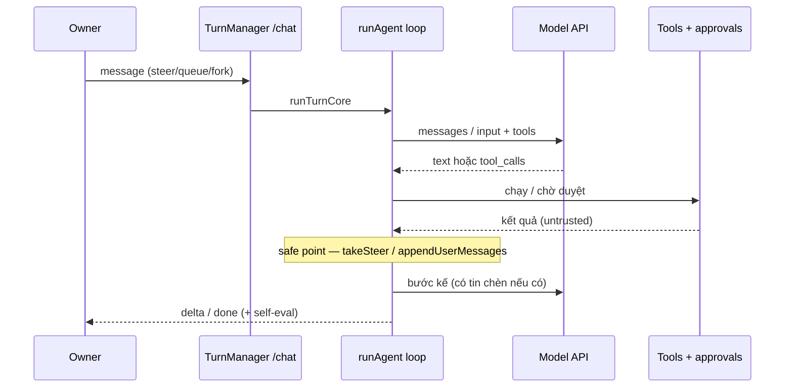
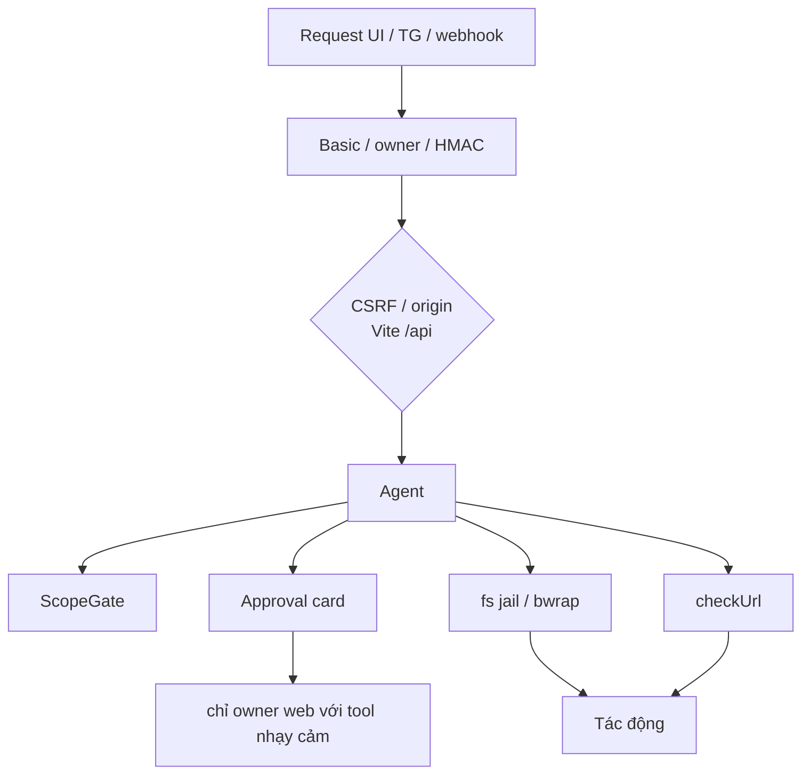

# 02 · Kiến trúc

Nguồn: `package.json`, `vite.config.ts`, `src/lib/agent/*`, `src/server/*`,
`docs/DEPLOY.md`, `docs/PHASE6-PROGRESS.md`, `docs/BRIDGE-PROTOCOL.md`,
`docs/WEBHOOK-API.md`.

## Stack ứng dụng

| Lớp | Công nghệ (theo dependencies / scripts) |
|---|---|
| UI | React 19, TanStack Router / Start / Query / Table |
| Build / dev | Vite 8, `@vitejs/plugin-react`, Tailwind 4 |
| Server trong dev | Vite middleware + route handlers TanStack Start (`src/routes/api/*`) |
| DB auth / app | Kysely + `@electric-sql/pglite` (migrate: `npm run db:migrate`) |
| Auth | `better-auth` (bearer + generic OAuth); HTTP basic qua `SABLE_PASSWORD` khi public |
| Agent runtime | TypeScript thuần, `node --experimental-strip-types` cho test/eval |
| MCP | `@modelcontextprotocol/sdk` |
| Browser tool | Playwright + Chromium |
| Desktop | Xvfb `:99`, x11vnc, websockify/noVNC, Chrome trong bwrap |

Cổng mặc định: **`SABLE_PORT=8080`**. Lệnh phát triển:

```sh
npm run dev                 # with-app-env + vite dev --host 0.0.0.0 --port 8080
npm run headless:start      # watchdog scripts/headless.mjs
```

`npm run build` chạy `vite build` rồi migrate. Nitro preset trong dự án là
`vercel`; trên VPS thường dùng đường headless `vite dev` như `docs/DEPLOY.md`
(harden CSRF/rate hiện gắn Vite).

## Nhà cung cấp mô hình

`src/lib/agent/provider.ts` (và eval/status):

| Provider | Style API | Biến khóa / model |
|---|---|---|
| xAI (mặc định trên box) | Responses (`XAI_API_STYLE`) | `XAI_API_KEY`, `XAI_MODELS` / `XAI_BASE_URL` |
| OpenAI-compatible | Chat completions | `OPENAI_API_KEY`, `OPENAI_BASE_URL`, `OPENAI_MODELS` |
| DeepSeek | Chat | `DEEPSEEK_API_KEY`, `DEEPSEEK_MODELS` |
| Generic `LLM_*` | Theo `LLM_API_STYLE` | `LLM_API_KEY`, `LLM_BASE_URL`, `LLM_MODELS` |
| Ollama | Chat (local) | `OLLAMA_BASE_URL` (mặc định `:11434` khi có `OLLAMA_MODELS`); `SABLE_OLLAMA=0` |
| Local (LM Studio / vLLM / …) | Chat | `LOCAL_BASE_URL`, `LOCAL_MODELS`, `LOCAL_API_KEY` |

Model router (W1): `SABLE_MODEL_HARD` (mặc định `grok-4.7`), `SABLE_MODEL_LIGHT` /
`SABLE_MODEL_CHEAP`; `SABLE_MODEL_ROUTER=0` luôn dùng hard. Thiếu mọi khóa LLM →
UI lên nhưng chat/media trả 503 (`startup.sh` cảnh báo, không echo giá trị).

## Vòng agent (tool loop)



- Adapter: `chatAdapter` (chat-completions) và `responsesAdapter` (Responses /
  `previous_response_id` hoặc stateless).
- Tools mang `risk`, timeout, `maxOutput`; nhiều tool `needsApproval`.
- Kết quả tool / MCP / inbound bridge được đánh dấu **untrusted data**, không
  phải lệnh.

## Turn manager (W7)

`src/lib/agent/turns/manager.ts` + `src/server/turns.server.ts`:

- Mỗi thread **tuần tự**; hàng đợi + inbox steer; session theo `turnId` (SSE
  `/api/turns/stream?turn=&after=` replay theo `seq`).
- Mode: `auto`/`steer` / `queue` / `interrupt` / `fork` (fork = job nền origin
  desk, initiator `owner:web`).
- Burst: tin đến trước output đầu và trong ~**1500 ms** → abort/restart một lượt
  với mọi tin (event `reset`).
- Cap toàn cục `SABLE_CHAT_CONCURRENCY` (mặc định 3, trừ slot heavy D7, tối thiểu 1).
- Kill: `SABLE_CHAT_QUEUE=0` → desk dùng `/api/chat` cũ; `/api/turns` 409.

## Router, planner, budget

- **Router 3 trục** (`SABLE_ROUTER`): `skills/routing.json` — chỉ skill lành;
  NOTICE tại `skills/_meta/NOTICE-reverse-skill.md`.
- **Planner** (`SABLE_PLANNER`): đồ thị task + checkpoint; workspace mỗi task
  (`SABLE_WORKSPACES`, gốc `SABLE_TASK_WORKSPACE_ROOT`).
- **Budget** (`SABLE_BUDGET`): `SABLE_BUDGET_MAX_TOKENS`, `SABLE_BUDGET_MAX_USD`;
  meter theo scope (chat, desktop, research, code, media…).
- **Heavy slots (D7):** `SABLE_HEAVY_MAX` (mặc định ≤2) chia sẻ desktop / research /
  code / spawn.

## Memory + vector hybrid

- Learned memory: `$SABLE_DATA_DIR/memory.json` (0600), cap `SABLE_MEMORY_MAX`
  (500), journal `SABLE_MEMORY_JOURNAL_DAYS` (365); nền chỉ đọc.
- Vector (`SABLE_VECTOR`): flat cosine store int8 dưới `sable-data/vector/`;
  embedder auto: OpenAI/xAI/local → **hash-v2-512** nếu thiếu khóa.
- Hybrid: 0.45 BM25 + 0.40 vector (+ recency); `knowledge_recall` + block
  `recall` trong `assemble` (budget `SABLE_RECALL_TOKENS`, mặc định 500).

## Jobs, routines, triggers

- Job service boot cùng process (plugin ping `/api/jobs`).
- Routine cron + builtin (ví dụ morning brief 07:30 Asia/Saigon, mặc định tắt;
  nightly-eval 03:00, mặc định tắt).
- Trigger: `POST /api/routines/<id>/fire` + `X-Sable-Secret`; watch URL/RSS qua
  `http_fetch` (SSRF). Kill: `SABLE_TRIGGERS=0` / `SABLE_JOBS=0` / `SABLE_ROUTINES=0`.

## Kênh

| Kênh | Cơ chế | Ghi chú |
|---|---|---|
| Telegram | Long-poll Bot API | Owner allowlist; W7 per-chat async + steer + ack ~5 s |
| Webhook | HMAC `X-Sable-Signature` | Schema v1; W7 `reply_to` / `mode` |
| SMTP | Nodemailer | Chỉ notify tới `SABLE_SMTP_TO` cố định; không duyệt qua mail |

## Bridge `sable.bridge.v1`

Một peer: outbound handoff (mỗi lần một thẻ Duyệt gửi) + inbound
`/api/bridge/inbound` (HMAC, replay 409, nội dung → Tasks kind `bridge`). Chi tiết
ký: `docs/BRIDGE-PROTOCOL.md`. Kill / chưa cấu hình: `SABLE_BRIDGE`.

## Desktop `:99`

Xvfb chỉ display **99** (không đụng `:1`/`:2`); Chrome bwrap + egress proxy SSRF;
x11vnc/websockify localhost; noVNC sau auth Sable. Mỗi click/type/key/scroll cần
duyệt; screenshot/wait không. Idle auto-stop (`SABLE_DESKTOP_IDLE_MIN`, mặc định
10). Kill: `SABLE_DESKTOP=0`.

## Research & code agents

- **Research:** plan → search (xAI `web_search`) → fetch SSRF → cite nguyên văn →
  verifier → Canvas; checkpoint; cap USD/steps; heavy slot.
- **Code:** `git worktree` dưới workspace, lệnh bwrap **không mạng**, apply/merge
  chỉ owner; **không push/PR** (D6). Repo bị bảo vệ gồm reverse-skill-research,
  openduet-research, data dir, v.v. (`SABLE_CODE_REPOS`).

## Lớp an toàn (tóm tắt)



- Approvals + `canDecide` / `decideAs` (audit initiator_kind).
- fs jail + bwrap shell/code/desktop; env Sable **không** truyền vào sandbox /
  desktop / eval con.
- SSRF trên fetch, webhook outbound, bridge, image URL, redirect từng hop.
- Vault AES-GCM (`SABLE_VAULT_KEY`); API list **chỉ tên**.
- Redaction secret trong log/trace/memory/bridge payload.
- Kill switches: xem [06-bao-mat-van-hanh.md](./06-bao-mat-van-hanh.md).
