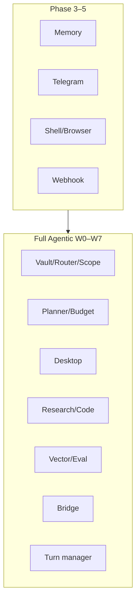

# 05 · Catalog tính năng (Phase → W7)

Mỗi mục: **làm gì**, **dùng thế nào**, **kill switch**. Chi tiết số đo/verify:
`docs/PHASE*-PROGRESS.md`, `docs/FULL-AGENTIC-STATUS.md`, `docs/PHASE6-PROGRESS.md`.

## Phase 1–2 (nền tảng desk — tóm theo code hiện hữu)

| Tính năng | Làm gì | Dùng | Kill / ghi chú |
|---|---|---|---|
| Chat interactive | Vòng model + tool, stream | UI desk | Cần LLM key |
| Công cụ file / fetch | Đọc-ghi trong workspace jail; HTTP SSRF | Chip công cụ | `SABLE_TOOLS`; duyệt ghi |
| Preset / model UI | Chọn model & effort | Thanh công cụ chat | — |
| Đính kèm | Upload vào context | Paperclip | — |

*(Phase 1–2 không có file tiến độ riêng dài như Phase 3+; hành vi nằm trong
`src/lib/agent` + desk.)*

## Phase 3 — Memory, Telegram, SMTP

| Tính năng | Làm gì | Dùng | Kill |
|---|---|---|---|
| Learned memory | Trích fact sau reply; inject ≤~3000 ký tự; UI quản lý | **Cách Sable làm việc → Sable tự ghi nhớ**; tool `memory_*`; nền chỉ đọc | `SABLE_MEMORY=0` |
| Telegram | Long-poll; owner private only; job nền + nút duyệt | `.env` token + owner ids; `/help` `/new` `/status` | unset token; `SABLE_CHANNELS=0` |
| SMTP notify | Gửi tới đúng `SABLE_SMTP_TO` | Kết quả/routine theo `SABLE_SMTP_NOTIFY` | thiếu SMTP; `SABLE_CHANNELS=0` |

## Phase 4 — Desk sync, spawn, skills, MCP, triggers, eval

| Tính năng | Làm gì | Dùng | Kill |
|---|---|---|---|
| Trusted origins | OAuth/CSRF origin | `SABLE_TRUSTED_ORIGINS` | — |
| Desk sync server | `desk.json` đa thiết bị | Panel đồng bộ | `SABLE_DESK_SYNC=0` |
| `spawn_agent` | Sub-agent research/writer/coder; depth 1 | Chat tool | `SABLE_SPAWN=0` |
| Skills | `skills/<name>/SKILL.md`; `load_skill` không cấp tool | Settings Skill; catalog ≤1500 | `SABLE_SKILLS=0` |
| MCP client | HTTP/SSE; tool `mcp__…`; SSRF | Settings Máy chủ MCP; `MCP_SERVERS` | `SABLE_MCP=0` |
| Routine triggers | Webhook fire + URL/RSS watch | Panel Trigger; `POST …/fire` | `SABLE_TRIGGERS=0` |
| Eval set | `evals/sable.jsonl` + `npm run eval` | CI / local | — |

## Phase 5 — Shell, browser, local models, webhook, voice, profiles, headless

| Tính năng | Làm gì | Dùng | Kill |
|---|---|---|---|
| Shell bwrap | `shell_run` unshare; luôn duyệt | Chip Shell | `SABLE_SHELL=0` |
| Browser Playwright | navigate/text/shot; click/type cần duyệt | Chip Browser | `SABLE_BROWSER=0` |
| Ollama / local | Chat-completions local | Env `OLLAMA_*` / `LOCAL_*` | `SABLE_OLLAMA=0` |
| Webhook channel | HMAC v1 events | `POST /api/channels/webhook` | `SABLE_WEBHOOK=0` |
| Voice STT/TTS | Mic + Đọc to | `/api/voice` | `SABLE_VOICE=0` |
| Profiles | sable/research/writer/coder + custom | Settings | `SABLE_PROFILES=0` |
| Headless 24/7 | Watchdog vite/jobs | `npm run headless:*` | — |

## W0 — Resilience, vault, router, scope

| Tính năng | Làm gì | Dùng | Kill |
|---|---|---|---|
| Heartbeat / catch-up | `POST /api/health`; routine catch-up ≤1 sau suspend | Watchdog tick | `SABLE_CATCHUP=0` |
| Vault AES-GCM | `vault.json` 0600; API names-only | Settings Vault | `SABLE_VAULT=0`; **cần** `SABLE_VAULT_KEY` |
| Router 3 trục | Gợi ý skill lành | `/api/router` | `SABLE_ROUTER=0` |
| ScopeGate | Fail-closed khi tắt | Duyệt scope | `SABLE_SCOPE=0` = deny ACT |
| Field journal | Ghi → memory journal | `/api/field-journal` | memory off |
| Tool-index | Quét PATH, **chỉ đề xuất** cài | `/api/tool-index` | `SABLE_TOOLINDEX=0` |

## W1 — Planner, workspace, budget

| Tính năng | Làm gì | Dùng | Kill |
|---|---|---|---|
| Planner graphs | Task + checkpoint | `/api/tasks`, UI Tasks | `SABLE_PLANNER=0` |
| Per-task workspace | Thư mục riêng mỗi task | Tự khi tạo task | `SABLE_WORKSPACES=0` |
| Budget + model router | Trần token/USD; hard/light | `/api/budget` | `SABLE_BUDGET=0` (vẫn meter) |
| Scope card UI | Đồng ý/Từ chối | Desk + nền | — |

## W2 — Trace, media, Canvas

| Tính năng | Làm gì | Dùng | Kill |
|---|---|---|---|
| Trace UI | Timeline run, export `sable.trace.v1` | Tab / `/api/traces` | `SABLE_TRACE=0` |
| Image / video | Gen + thư viện media | Tab Media; chip Ảnh/Video | `SABLE_MEDIA=0`; video **cần** provider |
| Canvas pages | HTML sandbox CSP; phiên bản | Mở cạnh chat; `canvas_write` duyệt | `SABLE_CANVAS=0` |

## W2a — Proactive

| Tính năng | Làm gì | Dùng | Kill |
|---|---|---|---|
| Triage | needs-reply / approval / FYI / ignore | Inbox; `/api/triage` | `SABLE_TRIAGE=0` |
| Morning brief | 07:30 Asia/Saigon; mặc định tắt | Brief / routine builtin | `SABLE_BRIEF=0` |
| Tasks inbox | Gộp task + duyệt + triage | UI Tasks | — |
| Reply chips | Approve / snooze / draft / open — **không gửi** | Inbox | `SABLE_PROACTIVE` |
| Audit initiator | user\|routine\|… trên side effect | `/api/audit` | — |

## W2b — OAuth Gmail + Calendar

| Tính năng | Làm gì | Dùng | Kill |
|---|---|---|---|
| Gmail | Đọc/search; draft; **send = duyệt** | Kết nối; tool gmail_* | `SABLE_OAUTH=0`; **cần** client + vault |
| Google Calendar | Đọc; ghi = duyệt; `sendUpdates=none` | Kết nối; tool gcal_* | như trên |

## W2c — Harden + share + media tool

| Tính năng | Làm gì | Dùng | Kill |
|---|---|---|---|
| Canvas share links | Token SHA-256; `/s/<token>` readonly | Background → Canvas → Link chỉ xem | `SABLE_SHARE=0` |
| Media tool agent | Gen ảnh qua tool + budget | Chat (khi bật) | `SABLE_MEDIA_TOOL=0` |
| Rate / body / CSRF | Vite middleware `/api` + `/s` | Tự động | `SABLE_RATE=0`, `SABLE_CSRF=0` |
| Held-out triage eval | Điểm trung thực 65% / 93.3% | `eval:w2c` | — |

## W3 — Desktop computer-use

| Tính năng | Làm gì | Dùng | Kill |
|---|---|---|---|
| Session `:99` | Xvfb + Chrome bwrap + noVNC | Tab Desktop → Bật | `SABLE_DESKTOP=0` |
| Actions | shot/wait không duyệt; click/type/key/scroll có | Agent / thẻ duyệt ảnh | — |
| Vision loop | Model đề xuất → duyệt → chạy | Goal → Chạy | cap USD/steps |

## W4 — Research + code

| Tính năng | Làm gì | Dùng | Kill |
|---|---|---|---|
| Deep research | Cite verified → Canvas | Tab Research | `SABLE_RESEARCH=0` |
| Code worktree | bwrap no-net; apply = merge local | Tab Code | `SABLE_CODEAGENT=0`; PR off |

## W5 — Vector + self-eval

| Tính năng | Làm gì | Dùng | Kill |
|---|---|---|---|
| Vector index | memory/journal/threads/canvas/research/docs | Tab Tìm nhớ; `/api/vector` | `SABLE_VECTOR=0` |
| Hybrid recall | BM25+vector+recency | `knowledge_recall`; context block | `SABLE_RECALL_CONTEXT=0` |
| Self-eval | Grade run; review queue; nightly off | Tab Eval | `SABLE_SELFEVAL=0` |

## W6 — Bridge

| Tính năng | Làm gì | Dùng | Kill |
|---|---|---|---|
| Outbound handoff | Ký HMAC; mỗi lần duyệt | Settings Bridge; tool `bridge_handoff` | `SABLE_BRIDGE=0` / chưa cấu hình |
| Inbound | Data → Tasks kind bridge | Peer POST `/api/bridge/inbound` | như trên |

## W7 — Non-blocking chat

| Tính năng | Làm gì | Dùng | Kill |
|---|---|---|---|
| Composer không khóa | Stop + Send; menu Xếp hàng / Song song / Dừng & gửi | Desk | `SABLE_CHAT_QUEUE=0` |
| Turn manager | Steer / queue / cap / SSE resume | `/api/turns` | như trên |
| Reply/quote | Chip Trả lời; `replyTo`; threaded fork | Nút Trả lời | — |
| TG/webhook async | Per-chat chain; steer; ack ~5s; `reply_to` | Telegram / WEBHOOK-API | `SABLE_CHANNEL_ACK_MS` |

