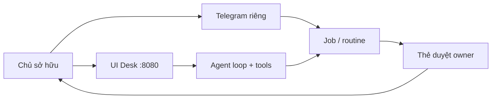

# Sable — Tài liệu tiếng Việt

Bộ tài liệu này mô tả **Sable** đúng như code và các file `docs/*.md` hiện có trong repo
[`VagabondKingsman/Sable-bot`](https://github.com/VagabondKingsman/Sable-bot).
Mọi số đo, lệnh, biến môi trường và hạn chế đều lấy từ nguồn đó; chỗ còn thiếu
credential của chủ sở hữu được ghi **cần cấu hình**.

| File | Nội dung |
|---|---|
| [01-gioi-thieu.md](./01-gioi-thieu.md) | Sable là gì, triết lý, ưu điểm đo được, hạn chế trung thực |
| [02-kien-truc.md](./02-kien-truc.md) | Stack, vòng agent, turn manager, memory, jobs, kênh, bridge, an toàn |
| [03-yeu-cau.md](./03-yeu-cau.md) | Hệ điều hành, Node, RAM, gói hệ thống, khóa bắt buộc / tùy chọn |
| [04-cai-dat-vps.md](./04-cai-dat-vps.md) | Cài từ đầu trên Ubuntu VPS: clone, `.env`, systemd, TLS, Telegram, OAuth |
| [05-tinh-nang.md](./05-tinh-nang.md) | Danh mục tính năng theo Phase 1–5 và W0–W7 |
| [06-bao-mat-van-hanh.md](./06-bao-mat-van-hanh.md) | Mô hình bảo mật, kill switch, bí mật, ops (log, watchdog, eval) |
| [07-faq.md](./07-faq.md) | Câu hỏi thường gặp + thuật ngữ |
| [08-cau-hinh-env.md](./08-cau-hinh-env.md) | `.env.example` / `.env.local`: tối thiểu boot, lấy credential, vault, kill switch, checklist |

Tài liệu tiếng Anh gốc (chi tiết kỹ thuật / protocol):

- `docs/FULL-AGENTIC-STATUS.md` — trạng thái W0–W6 + checklist VPS
- `docs/PHASE6-PROGRESS.md` — nhật ký từng wave (kể cả W7)
- `docs/DEPLOY.md` — chạy headless 24/7
- `docs/PHASE3-SETUP.md` — memory, Telegram, SMTP
- `docs/OAUTH-SETUP.md` — Gmail + Google Calendar
- `docs/WEBHOOK-API.md` — kênh webhook `v: 1`
- `docs/BRIDGE-PROTOCOL.md` — `sable.bridge.v1`
- `docs/CANVAS-SHARE.md` — link chỉ xem Canvas

---

## Sable là gì (một trang)

**Sable** là **agent bàn làm việc một người dùng** (single-operator desk agent): một
process Node phục vụ UI/API trên cổng `8080`, lịch job/routine, long-poll Telegram,
SMTP notify và webhook. Không thiết kế multi-tenant; chủ sở hữu (owner) là người
duy nhất được phép duyệt hành động ghi/gửi.

**Dành cho ai.** Người muốn một agent cá nhân chạy 24/7 trên VPS/máy riêng, với
công cụ (file, shell bwrap, browser, desktop `:99`, research, code worktree),
bộ nhớ học được, và mọi thao tác gửi/ghi đều qua thẻ duyệt — không phải chatbot
chỉ trả lời chữ.

**Không phải.** Sản phẩm SaaS đa thuê bao; bot Discord/Slack (đã loại khỏi phạm
vi Phase 5); công cụ RE/pentest/CTF (cố ý không có trong skill).

**Trạng thái xây dựng (theo `docs/FULL-AGENTIC-STATUS.md` + W7).** Phase 1–5 và
Full Agentic W0–W7 đã ship trong repo; một số tính năng vẫn **cần cấu hình**
(vault key, Google OAuth, Telegram token, embeddings thật, bridge peer). Chạy
hiện tại trên box phát triển dùng `npm run dev` / `npm run headless:start`
(Vite), không phải bản Nitro production đầy đủ harden middleware.

Cập nhật tài liệu này: khi đổi code/tính năng, sửa file `docs/vi/` tương ứng và
các nguồn tiếng Anh nêu trên.
